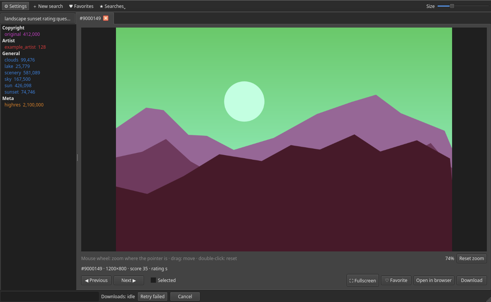
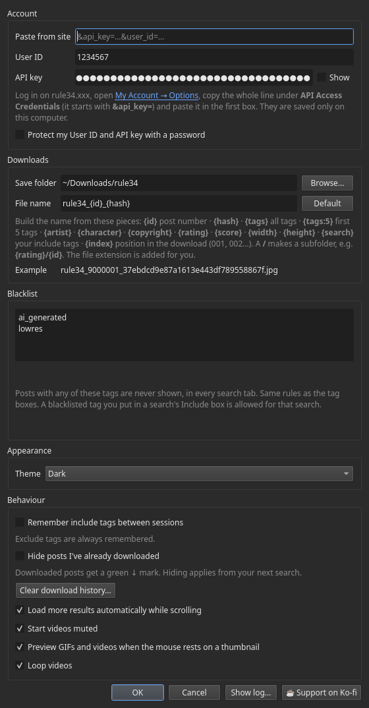

# R34 Downloader

A desktop app for Linux to search rule34.xxx and e-hentai.org, preview posts (pictures, GIFs and videos) and
galleries, and download them one at a time or in bulk. It ships as a single AppImage that brings its own Python and Qt, so it runs on any
reasonably recent distribution without installing anything.

**18+ only.** This is a tool for an adult website.

Current version: **1.3.0**

| Post tab: coloured tag list, zoomable picture | Settings | Slideshow options |
|---|---|---|
|  |  |  |

*Screenshots use made-up sample posts.*

## Features

### Searching
- **Search tabs:** each tab has its own include and exclude tag boxes, its own results, ticks and paging.
  Open a new one with **＋ New search** (Ctrl+T).
- **Tag boxes:** one tag per line (spaces and commas work too). Inside a tag, use `_` instead of a space
  (`long_hair`). Site extras work: `rating:questionable`, `rating:explicit`, `sort:score`, `score:>=50`.
  Ctrl+Enter searches.
- **Tag suggestions:** both boxes suggest tags as you type, with how many posts each has.
- **Universal blacklist** (Settings): tags left out of every search. A tag you explicitly include wins.
- **Infinite scroll** or **page mode** (Settings): page mode has ◀/▶ page buttons and jump-to-page, and ticks are
  kept across pages. The count line shows which page you're on and how many results the search has in all.
  Infinite scroll loads 10 pages by itself, then shows **Load more** so a huge search doesn't load everything.
- **★ Searches menu:** saved searches (save, load and delete the current tab's tags) and **followed tags**
  (one-click searches; follow a tag from its right-click menu in a post tab).
- The first tab's exclude list is always remembered. A setting also remembers the include tags.

### The results grid
- Thumbnails with a tick box in the corner. **All / None / Invert**, and Shift+click to tick a range.
- **Size** slider in the toolbar, or Ctrl + mouse wheel over the grid. **Sharper thumbnails** (Settings): above
  250 px, rule34.xxx thumbnails use the post's bigger sample picture (more data per thumbnail).
- **Hover previews:** GIFs and videos play in place when the mouse rests on them (can be turned off).
- A green **↓** marks posts you downloaded before; a setting hides them from new searches.
- **♥** marks favorites.
- Right-click a thumbnail: open in a tab or background tab, open in browser, download, add to favorites.

### Post tabs
- Click a thumbnail to open the post in its own tab; Ctrl+click or middle-click opens it in the background.
  Nothing else is interrupted.
- **Pictures:** mouse-wheel zoom toward the pointer (up to 400%), drag to move, double-click or **Reset zoom**.
  Zooming past screen size loads a sharper copy.
- **GIFs and videos:** click or Space to pause, a seek bar you can click anywhere on, mute and volume. Settings
  choose whether videos start muted and whether they loop.
- **◀ Previous / Next ▶** (or the arrow keys) step through the search the post came from, loading more results
  at the end.
- **⛶ Fullscreen** (F, or double-click a video or GIF): only the media on black. The controls appear when the
  mouse moves and hide after 2 seconds. Esc or F leaves.
- **Tag list** grouped and coloured like the site (Copyright, Character, Artist, General, Meta) with post counts.
  Click a tag to search it in a new tab; right-click to add it to include/exclude, copy it, or follow it.
- Buttons for **Download**, **♥ Favorite**, **Open in browser**, and a **Selected** tick that mirrors the grid.

### Favorites
- **♥ Favorites** in the toolbar opens your favorites as a grid with the same ticking and downloading.
- Its tag boxes filter your favorites on this computer (no searching the site). `rating:` and `-tag` work, and
  the blacklist applies.
- **Download all** downloads every favorite shown (the filter applies) as files, a folder or a ZIP, skipping the
  ones you already downloaded.
- **Backup** (Settings → Backup → Export… / Import…): one file with your favorites, saved searches, followed tags,
  blacklists and settings, to keep or move to another computer. Download history and your logins go in only if
  you tick them (logins are stored as plain text, so keep that file private). Importing can **merge** (add the
  file's favorites, searches, tags and history to yours) or **replace** (take everything from the file).

### Slideshow
- **▶ Slideshow** on a search tab or Favorites shows the posts full screen, one after another.
- Options (remembered): seconds per picture, shuffle, include GIFs (each plays through at least once), include
  videos (whole or capped to N seconds), sound, start again at the end, or only the ticked posts.
- Keys: Space pause · ←/→ previous/next · F favorite · D download · Esc leave.
- It keeps fetching the search's next pages by itself, and downloads the next picture ahead so changes are
  instant.
- Fullscreen and the slideshow keep the screen from blanking while open.

### Downloading
- **Download N** downloads the ticked posts. Three downloads run at once, failed ones are retried, and the
  status bar has **Retry failed** and **Cancel**.
- **Download as folder…** or **Download as ZIP…** (the arrow on the Download button) saves the ticked posts as
  one numbered album. The name is suggested from the shared artist.
- **Open together:** the ticked posts side by side in one tab; ◀/▶ in posts opened from it step through just
  those.
- Every download is remembered in a history (the green ↓ mark).

### File names
The name template is set in Settings per site, with a live preview. The defaults are `rule34_{id}_{hash}` for
rule34.xxx and `ehentai_{album_id}_{page}` for e-hentai.
A `/` in the template makes subfolders.

| Token | Meaning |
|---|---|
| `{id}` | post number |
| `{hash}` | the file's hash (md5) |
| `{ext}` | file extension (added automatically at the end) |
| `{tags}` / `{tags:5}` | all tags / the first 5 tags, joined with `_` |
| `{artist}` `{character}` `{copyright}` | from the post's tag types; several are joined with `+` |
| `{search}` | the include tags of the search the post came from |
| `{rating}` `{score}` `{width}` `{height}` | post details |
| `{index}` | position in an album download (001, 002, …) |
| `{site}` | the site (`rule34.xxx`, `e-hentai`) |
| `{album}` `{album_id}` `{page}` | e-hentai: gallery title, gallery number, page number (001, 002, …) |

Names are cleaned for the file system and shortened if too long; an existing file is never overwritten
(`_1`, `_2`… is added).

### Look and privacy
- **Themes:** System (follows the desktop), Light, Dark, Black (OLED), R34 (greens), Sunset, Midnight, Pink,
  Black & Gold. Applied instantly; tag colours adjust to stay readable on each.
- **Optional master password** for the User ID, API key and e-hentai login: encrypted with scrypt + AES-GCM, asked once at
  startup. A forgotten password can't be recovered; you enter the key again from your rule34.xxx account.
- **Log viewer** (Settings → Show log…). API keys are removed from every log line.

## e-hentai.org

Pick **e-hentai** in the site picker above the tag boxes. Everything works without an account.

- **Search** works like the site's own search box: words match gallery titles, and tags can go in too, e.g.
  `my title language:english female:"long hair$"`. Clicking a tag's Include adds it in that form. The exclude
  box takes tags, one per line or comma-separated (spaces are part of the tag): `male:yaoi`. The grid shows one
  cover per gallery with its page count; scrolling loads more. The blacklist, saved searches and
  followed tags are kept per site.
- **Open a gallery:** a gallery tab with its title, category and tags, and its pages as a thumbnail grid (ticking,
  **Download**, **Download as folder/ZIP…**, **Open together** and **Slideshow** work as in a search).
- **View:** a page opens in a post tab (◀/▶ step through the gallery) or in the slideshow.
- **Download** ticked pages, ticked galleries (all their pages), or a gallery as one folder or ZIP. Files are
  named `ehentai_<gallery>_<page>` by default. Favorites and the download history are kept per site.

**Pacing and image limits.** The app talks to e-hentai one request at a time, at least a second apart, with a
5-second pause after every 4 requests, and backs off when the site says it's busy. Every picture costs one page
load plus the picture, so a 100-page gallery takes a few minutes. e-hentai counts the pictures you view against an
image limit (per IP address, or per account when logged in); when it's reached, downloads pause and the status bar
has **Resume e-hentai downloads** for later. Downloads of more than 200 pictures ask first. If e-hentai says pages are opened too
fast, the app stops for a while; downloads pause too.

**Optional login (originals).** Without a login, downloads save the resized copy the site shows (usually up to
1280 px wide). With a login, downloads save the original file when the page offers one (viewing and the slideshow
still use the resized copy). Originals use more of your image limit. To log in, sign in on e-hentai.org in your
browser, open the developer tools (F12) → **Storage** (Firefox) or **Application** (Chrome) → **Cookies** →
`https://e-hentai.org`, and copy the values of `ipb_member_id` and `ipb_pass_hash` into **Settings → e-hentai
login**. They're stored like the rule34.xxx key: in the settings file, or encrypted with the master password.

Not supported: exhentai.org, torrents and archive downloads.

## Getting an API key

On rule34.xxx: My Account → Options → **API Access Credentials**. Copy the whole line shown there (it looks
like `&api_key=…&user_id=…`) and paste it into **Paste from site** in the app's Settings, which opens by itself
the first time. The User ID and API key are filled in for you.

## Run

    chmod +x R34-Downloader-x86_64.AppImage
    ./R34-Downloader-x86_64.AppImage

From source (Python 3.10+):

    pip install -e .
    python -m r34dl

## Build the AppImage

    bash packaging/build-appimage.sh

This produces `R34-Downloader-x86_64.AppImage` (x86_64, glibc 2.34 or newer: Ubuntu 22.04+, Debian 12+,
Fedora 35+). It bundles python-build-standalone, PySide6 (Qt 6, including multimedia) and `cryptography`, all
pinned by version and checksum, so the build needs network access. The build checks that every library resolves
inside the AppImage and that the app starts with the host's Qt hidden.

## Tests

    pip install -e '.[dev]'
    python -m pytest

## Where things are stored

All files are readable only by you (mode 0600).

| What | Where |
|---|---|
| Settings (and the credentials, encrypted if a password is set) | `~/.config/r34-downloader/config.json` |
| Download history | `~/.local/share/r34-downloader/history.txt` (e-hentai: `history-e-hentai.txt`) |
| Favorites | `~/.local/share/r34-downloader/favorites.json` (e-hentai: `favorites-e-hentai.json`) |
| Log | `~/.local/state/r34-downloader/log.txt` |

These follow `$XDG_CONFIG_HOME`, `$XDG_DATA_HOME` and `$XDG_STATE_HOME` when set. Downloads go to
`~/Downloads/rule34` by default (changeable in Settings or with **Choose folder…**).

Without a master password, the User ID, API key and e-hentai login are stored in plain text in the settings
file.

## Support

If the app is useful to you, you can buy the project a coffee on
[Ko-fi](https://ko-fi.com/r34bulkdownloader). It's entirely optional.

## License

R34 Downloader is free software under the [GNU General Public License v3.0](LICENSE). The AppImage bundles
Python, Qt (PySide6), FFmpeg and a few small libraries under their own licenses; see
[THIRD-PARTY-NOTICES.md](THIRD-PARTY-NOTICES.md).

This project isn't affiliated with rule34.xxx or e-hentai.org. Follow the site's rules and your local laws.

## Plans

See [TODO.md](TODO.md): other boorus and exhentai.org.
